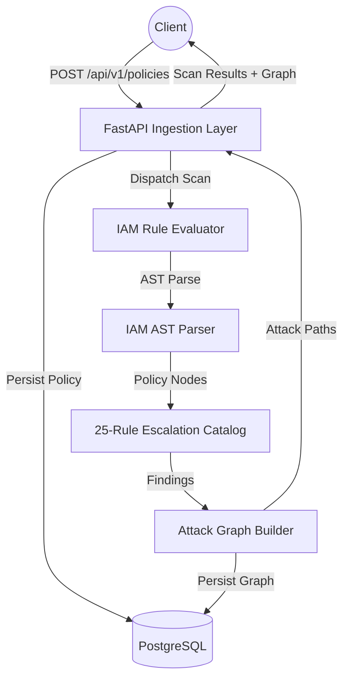
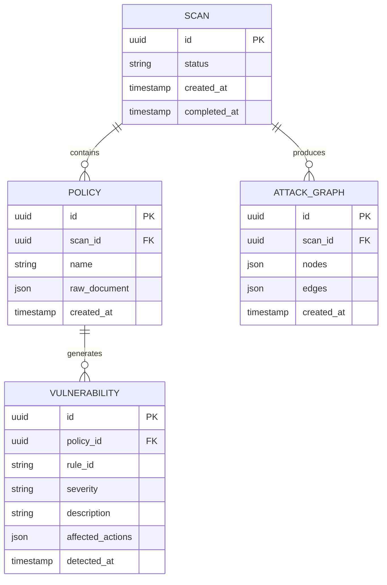
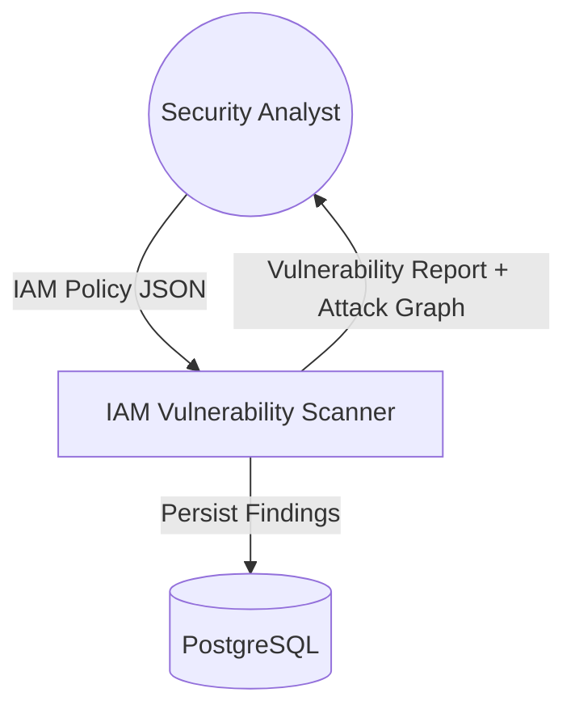
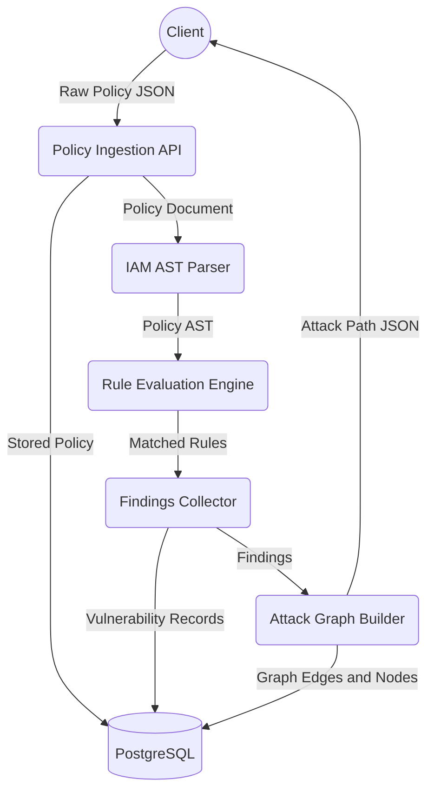
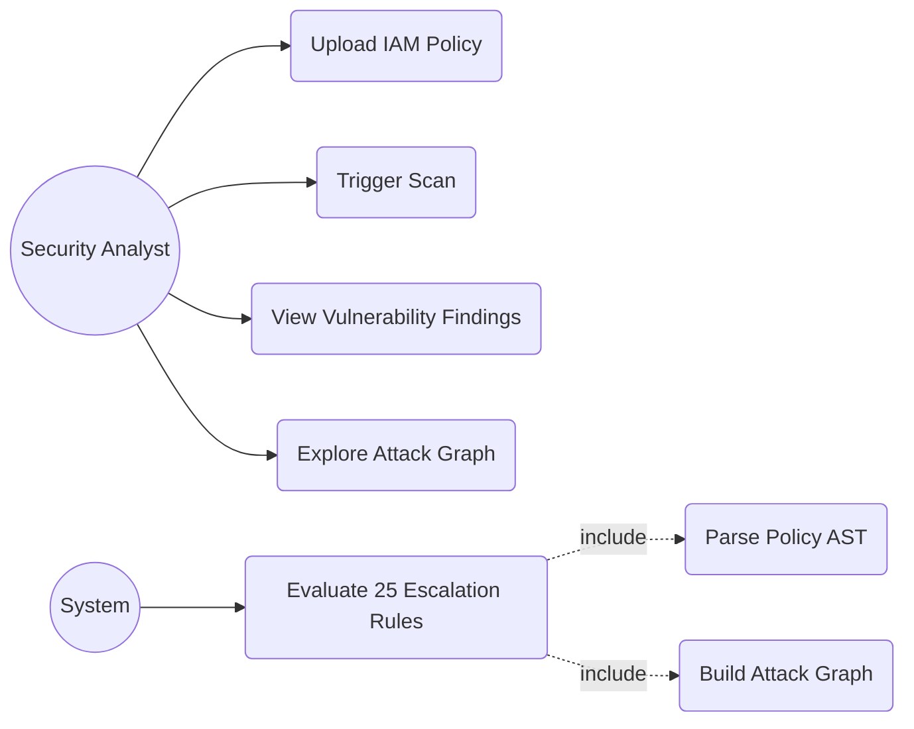
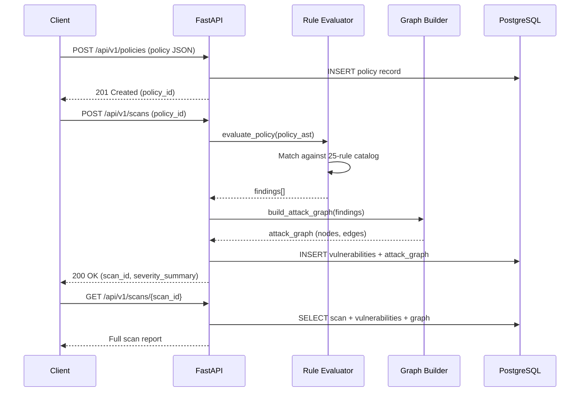

# IAM Vulnerability Scanner

## The Problem

AWS IAM misconfiguration is the leading cause of cloud breaches. Security teams lack automated tooling to detect privilege escalation paths buried inside complex IAM policy documents. Manual review of hundreds of policies is error-prone and operationally unsustainable. This engine automates full-depth static analysis of IAM JSON policies, maps all privilege escalation vectors across 25 known attack patterns, and constructs a navigable attack graph of role relationships.

## The Architecture

The system is a Python-first backend built on FastAPI with async PostgreSQL persistence via SQLAlchemy. At its core is a deterministic rule evaluation engine that parses IAM policy JSON into an AST (Abstract Syntax Tree), evaluates each statement against a 25-rule escalation catalog, and feeds results into a graph builder that models role chaining and trust relationship paths. The REST API exposes policy ingestion, scan execution, and results retrieval.



## Entity Relationship Diagram



## Data Flow Diagram (Level 0)



## Data Flow Diagram (Level 1)



## Use Case Diagram



## Sequence Diagram



## Tech Stack

| Layer | Technology |
|---|---|
| Language | Python 3.11 |
| API Framework | FastAPI |
| ORM | SQLAlchemy (async) |
| Database | PostgreSQL |
| Validation | Pydantic v2 |
| Testing | pytest (167 tests, 0 failures) |
| IAM Rules | 25-rule privilege escalation catalog |
| Containerization | Docker (planned) |

## Privilege Escalation Rules Covered

**Critical Severity (10 rules)**
- Admin wildcard (`*:*`)
- CreatePolicyVersion
- PutUserPolicy / PutGroupPolicy / PutRolePolicy
- AttachUserPolicy / AttachGroupPolicy / AttachRolePolicy
- AddUserToGroup
- UpdateAssumeRolePolicy

**High Severity (14 rules)**
- PassRole via EC2, Lambda, Glue, CloudFormation, CodeBuild, ECS, SageMaker, DataPipeline
- CreateAccessKey, CreateLoginProfile, UpdateLoginProfile
- SetDefaultPolicyVersion, LambdaUpdateFunctionCode, LambdaAddEventSource

**Medium Severity (1 rule)**
- STS AssumeRole chaining

## Local Setup

```bash
git clone https://github.com/kholipha-ahmmad-al-amin/iam-vuln-scanner.git
cd iam-vuln-scanner/backend

python -m venv .venv
.venv\Scripts\activate        # Windows
# source .venv/bin/activate   # Linux/Mac

pip install -r requirements.txt

# Run tests
pytest tests/ -v

# Start API server (requires DATABASE_URL env var for persistence)
uvicorn app.main:app --reload --port 8000
```

To scan a sample policy:
```bash
curl -X POST http://localhost:8000/api/v1/policies \
  -H "Content-Type: application/json" \
  -d @backend/samples/vulnerable_passrole_ec2.json
```

---

Developed by Kholipha Ahmmad Al-Amin
Founder and CEO, EquiSaaS BD | Principal Consultant, AR IT Consultancy
Expertise: Full Stack Enterprise Architecture & AI Engineering
GitHub: https://github.com/kholipha-ahmmad-al-amin
LinkedIn: https://www.linkedin.com/in/kholipha-ahmmad-al-amin
Portfolio: https://kholipha-ahmmad-al-amin.equisaas-bd.com
Email: kholifaahmadalamin@gmail.com
